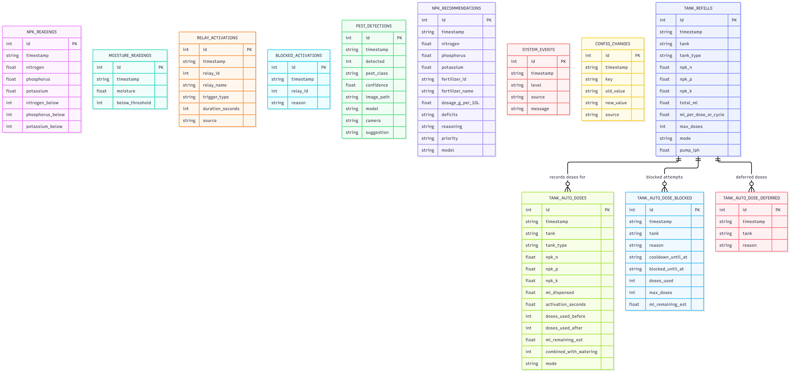
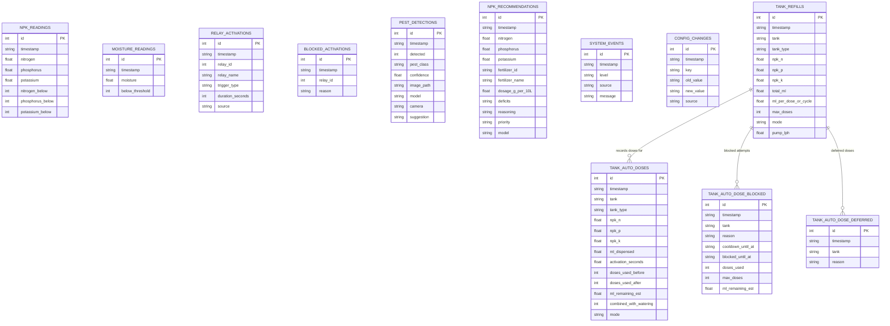

# VeggieCare — Database ERD

Entity-relationship diagram of the SQLite database (WAL mode). There are no
foreign-key constraints; relationships shown are logical (e.g. tank doses are
recorded against a prior tank refill for the same tank).

