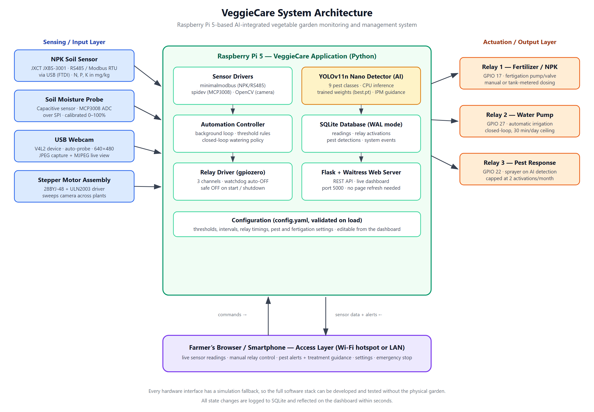
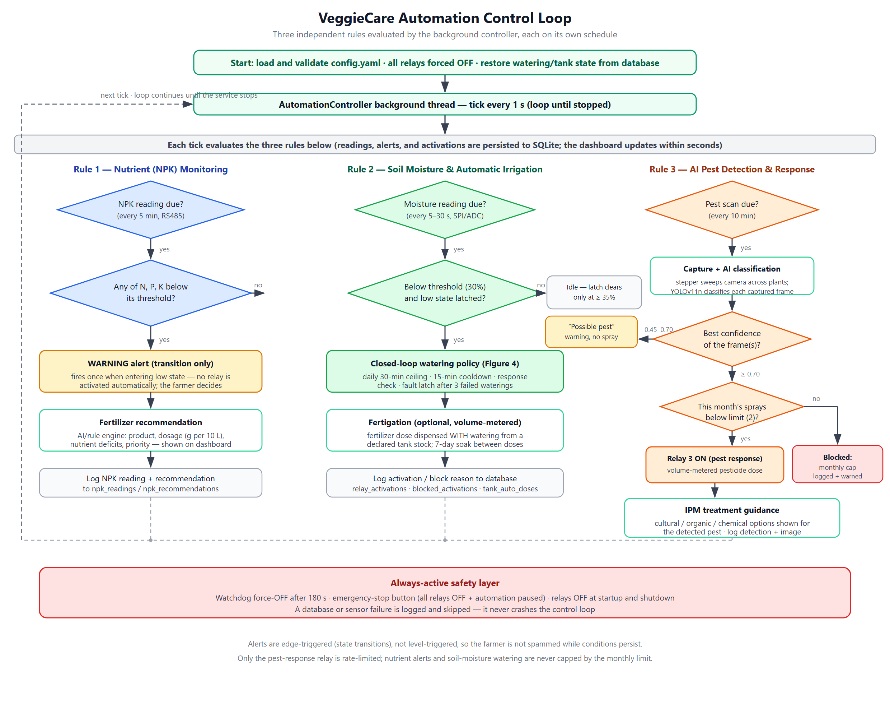
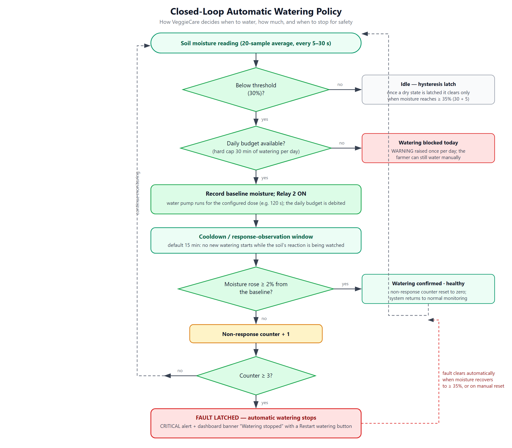
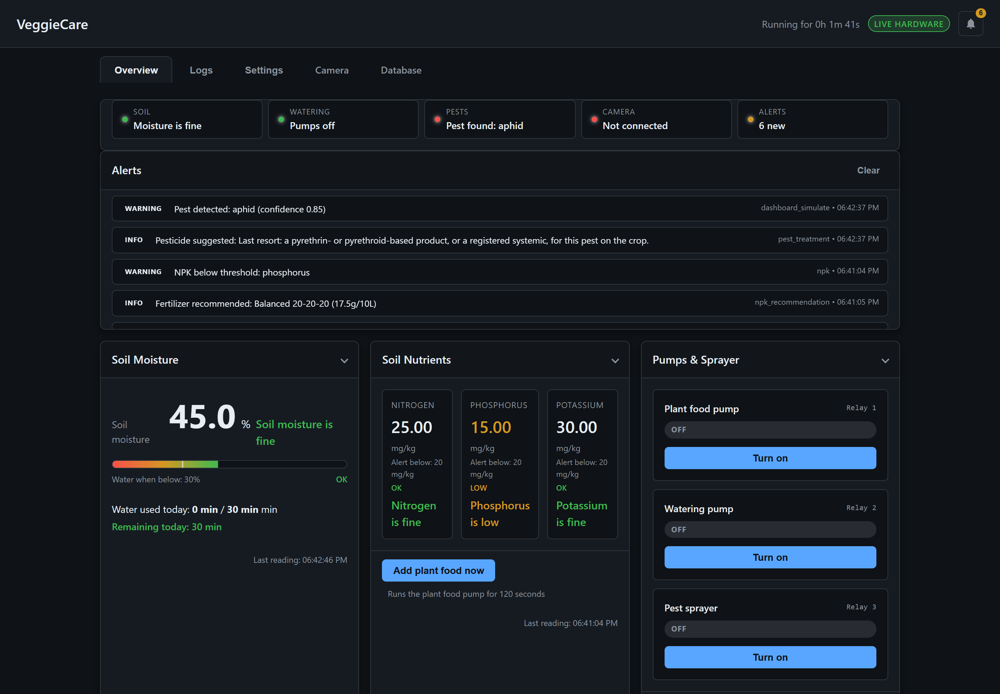
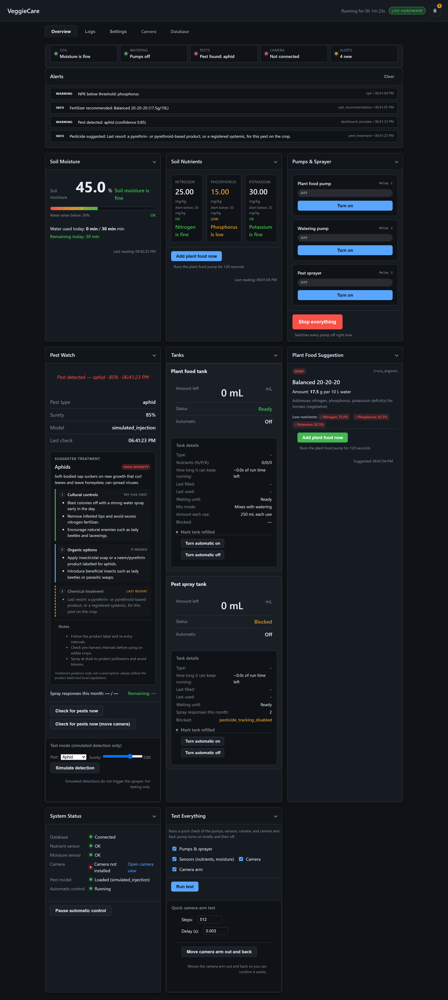
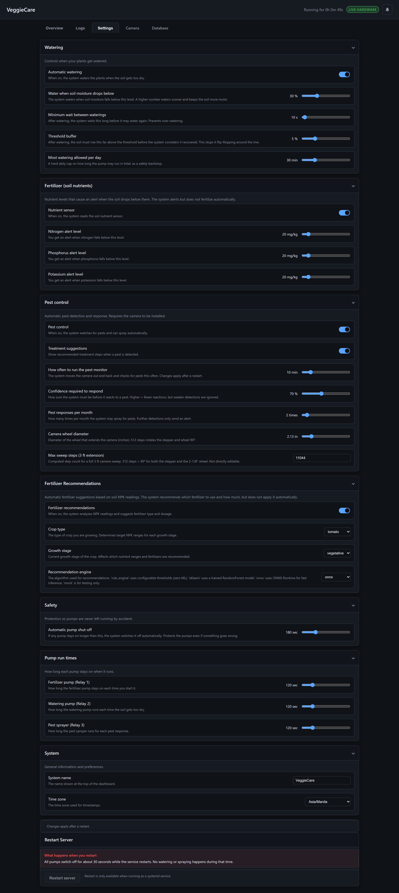
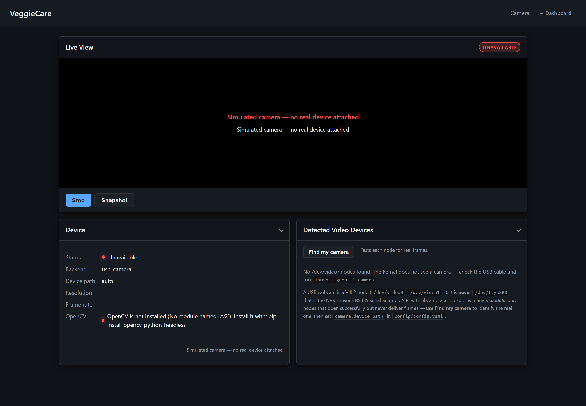
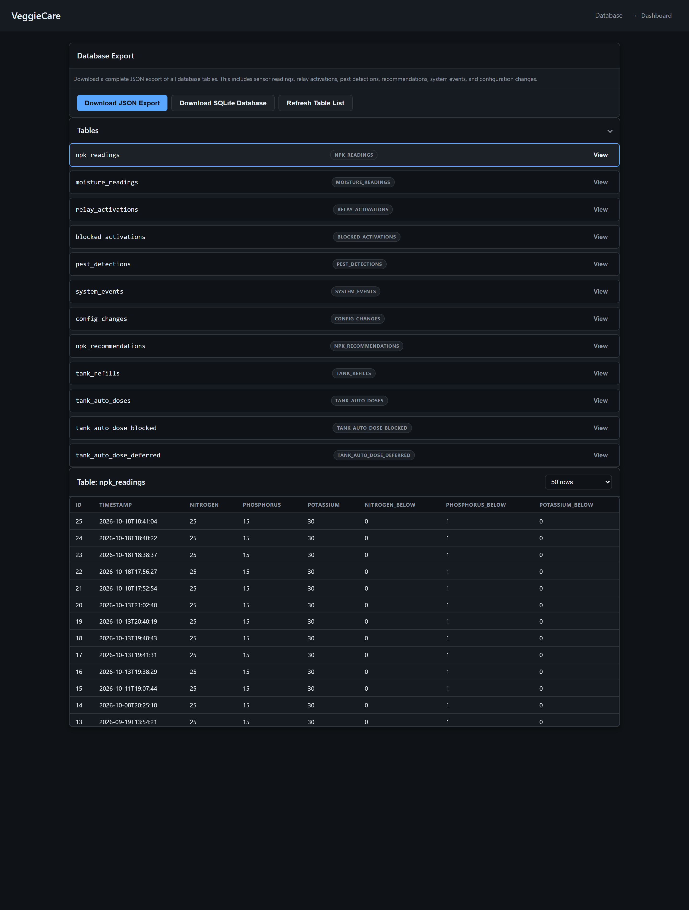

# CHAPTER 4

## PRESENTATION, ANALYSIS, AND INTERPRETATION OF RESULTS

This chapter presents the developed VeggieCare system — an AI-integrated vegetable garden monitoring and management system built on a Raspberry Pi 5. The results are organized around the four statements of problem of this study: (1) how the system was developed, (2) the benefits it provides to farmers, (3) the materials, hardware, and software required to build it, and (4) the functions and features it performs for irrigation control, soil monitoring, and pest detection. Each subsection analyses the implemented system as it actually operates, using the system's own architecture diagrams, live interface captures, and recorded configuration values as evidence.

---

## 4.1 Answer to Problem 1: How the AI-Integrated System Was Developed

> *How can an AI-Integrated system be developed to automate irrigation, monitor soil conditions, and assist in pest management for vegetable farmers?*

The study addressed this problem by building a single, modular software system that fuses three capabilities — automated irrigation, continuous soil monitoring, and AI-assisted pest management — around one low-cost computer, the Raspberry Pi 5. The system was engineered in four layers: a **sensing layer** that reads the garden, a **control layer** that decides what to do, an **actuation layer** that carries out the decisions through pumps and sprayers, and an **access layer** — a web dashboard — through which the farmer observes and overrides everything. Figure 1 shows the resulting architecture.

**Figure 1.** VeggieCare system architecture showing the sensing, control, actuation, and access layers.

### 4.1.1 Modular, Simulation-First Development Approach

The system was developed incrementally using a simulation-first strategy. Every hardware interface — the RS485 NPK sensor, the SPI analog-to-digital converter for moisture, the GPIO relays, the webcam, and the stepper motor — was written behind a small abstraction with a simulated fallback. This allowed the entire software stack, including the automation logic and the artificial-intelligence components, to be developed and exercised on an ordinary desktop computer (`python app.py --simulate`) long before it was deployed to the garden. Each module is configured from a single validated configuration file, `config/config.yaml`; the loader rejects the whole configuration on any error (invalid GPIO pin conflicts, out-of-range values, misconfigured sensor ports), so a mistyped setting can never silently disable a safety feature. Configuration is editable from the dashboard itself, and the farmer can therefore adjust thresholds, timings, and limits without touching source code.

Correctness was established through an automated test suite of **19 test modules** covering configuration validation, database operations, the automation rules, the closed-loop watering state machine, tank volume accounting, the YOLO and mock pest detectors, scan outcomes, treatment guidance, the fertilizer recommender, the relay watchdog, camera behavior, the dashboard API, and full-system integration. All tests run in simulated mode, which made it possible to verify hazardous edge cases — such as a pump that runs but delivers no water — safely and repeatably.

### 4.1.2 The Automation Core: Three Rules on One Background Loop

Irrigation and monitoring decisions are made by a background controller thread that ticks once per second, independent of the dashboard, so that a slow or disconnected browser can never delay a watering decision. Each tick evaluates three rules, each on its own sensing schedule, as shown in Figure 2.

**Figure 2.** The automation control loop: nutrient monitoring (alert-only), closed-loop irrigation, and AI pest detection and response.

1. **Nutrient (NPK) monitoring — decision support, not automation.** The NPK sensor is polled every five minutes. When nitrogen, phosphorus, or potassium falls below its configured threshold, the system raises a warning *only on the transition* into the deficient state (once, not every tick), and a fertilizer recommender produces a specific suggestion — product, dosage in grams per ten liters of water, the nutrient deficits that triggered it, and a priority level. Notably, the researchers deliberately chose **not** to automate fertilization: nutrient decisions remain human, because mis-dosed fertilizer damages soil and crops far more easily than missed watering.

2. **Soil-moisture irrigation — a closed loop, not a simple trigger.** Automatic watering is governed by a multi-layer policy presented in Figure 3 and analysed in Section 4.4.1.

3. **AI pest detection and response.** Every ten minutes the system captures images — driving a stepper motor to sweep the camera across the planting area for broader coverage — and classifies them with a fine-tuned YOLOv11 Nano model. Confirmed detections may trigger the pest-response relay, subject to a monthly cap, and raise integrated-pest-management (IPM) treatment guidance for the farmer.

**Figure 3.** The closed-loop watering policy: threshold and hysteresis, daily budget, response verification, and fault latching.

### 4.1.3 Integrating Artificial Intelligence

Two AI components were integrated, each chosen to match the modest compute budget of a single-board computer:

- **Pest recognition.** A YOLOv11 Nano image-classification model (input size 224×224) was fine-tuned on a locally assembled, labelled image dataset of nine vegetable-pest classes. Because a whole-frame classifier's confidence naturally fluctuates near its decision boundary, the detector implements a **confidence band**: results at or above 0.70 confidence are treated as confirmed detections and may trigger a response; results between 0.45 and 0.70 raise a "possible pest" warning *without* spraying anything; results below 0.45 are reported as clear. Manual "Check now" scans capture multiple frames and keep the best result, stopping early once a confirmed detection is found. This banding directly translates model uncertainty into conservative, farmer-safe behavior.

- **Fertilizer recommendation.** A machine-learning model (a random-forest classifier exported to ONNX) predicts the most suitable fertilizer from the measured NPK values, the selected crop, and its growth stage; a built-in rule-based engine using crop- and stage-specific target ranges serves as a transparent fallback. Both engines return the same structured output: fertilizer name, dosage in grams per ten liters, per-nutrient deficits, reasoning, and priority.

A third AI-adjacent component, the **treatment advisor**, maps each recognized pest to IPM-first guidance (cultural, organic, and finally chemical options, each with safety notes about product labels, pre-harvest intervals, and pollinator protection), so that detection produces actionable, responsible advice rather than only an alarm.

### 4.1.4 Safety Engineering

Because the system controls water, fertilizer, and pesticide pumps, safety was treated as a first-class design requirement rather than an afterthought: a hardware watchdog force-switches any relay off after 180 seconds regardless of software state; all relays are forced off at startup and shutdown; an emergency-stop control kills every relay and pauses automation in one action; watering state is re-seeded from the database after a restart so a crash cannot bypass the cooldown or daily budget; and a database or sensor failure is logged and skipped rather than crashing the control loop. These layers are shown at the bottom of Figure 2 and their user-facing manifestations are presented in Section 4.4.

---

## 4.2 Answer to Problem 2: Benefits Gained by Farmers

> *What benefits can farmers gain after using the developed system in managing their vegetable gardens?*

The benefits below are derived from the implemented capabilities of the system as presented in this chapter. They fall into three groups: resource savings, crop protection, and decision support.

**Water is used only when the plants need it, and only as much as is effective.** Conventional fixed-schedule watering irrigates on a fixed schedule whether the soil is wet or dry. VeggieCare waters only when measured moisture drops below threshold, adds hysteresis so that a reading oscillating around the threshold cannot re-trigger the pump, waits a cooldown before watering again, and — most importantly — *verifies that each watering worked*: if soil moisture does not measurably rise after a watering, the system records a non-response, and after three consecutive failures it stops watering entirely and alerts the farmer. This single mechanism saves water twice — it prevents needless irrigation, and it catches hidden failures (an empty tank, a blocked dripper, a burned-out pump) that would otherwise irrigate silently all season while the garden dried. A hard ceiling of 30 watering-minutes per day bounds the worst case even if every sensor fails.

**The garden is tended even when the farmer is away.** Irrigation runs day and night without supervision; the farmer receives alerts instead of performing twice-daily manual inspection. For smallholder vegetable growers, whose plots are often tended alongside other work, this converts a daily chore into an exception-driven task.

**Pests are found early and treated responsibly.** The camera sweeps the garden every ten minutes, catching infestations at the "possible" or early-confirmed stage rather than when damage is already visible to routine inspection. Crucially, spraying is deliberately conservative: no spray is released on uncertain detections (confidence below 0.70), the pesticide relay is capped at two activations per calendar month, every blocked activation is logged, and each confirmed detection is accompanied by IPM guidance that recommends cultural and organic controls before chemical ones. The farmer therefore loses less crop to pests while applying less pesticide, at lower cost and lower residue risk.

**Fertilization becomes a measured decision instead of a guess.** The NPK sensor converts "the plants look pale" into numbers, and the recommender converts those numbers into a named product and a precise dosage. This reduces the two classic fertilizer errors — over-application (wasted money, nutrient runoff, salt buildup) and under-application (stunted growth) — and gives the farmer a written record of what was suggested and why.

**Everything is documented automatically.** Every reading, relay activation, blocked activation, recommendation, detection, and system event is logged to a local database with timestamps, and the records can be viewed in the browser or exported. The farmer gains a season-long history for analyzing what worked, and the system's operation is fully auditable.

**The system is safe, affordable, and offline.** It is built entirely from commodity hardware and free software, has no cloud dependency or subscription, and serves its dashboard over local Wi-Fi — usable on a farm with no internet connection. The watchdog, emergency stop, and daily caps protect both the crop and the physical equipment.

**The farmer stays in control.** Automation can be paused at any moment, every relay has a manual button, watering has a one-touch reset after a fault, and fertilization is intentionally kept as assisted-manual. The system automates the tedious and the time-critical; the agronomic decisions remain the farmer's.

**Table 1.** Summary of farmer benefits and the system capabilities that produce them.

| # | Benefit | Produced by |
|---|---------|-------------|
| 1 | Water and cost savings; protection from over- and under-watering | Threshold + hysteresis + cooldown + response verification + 30-min daily cap (Figure 3) |
| 2 | Early detection of pump, pipe, or tank failures | Non-response fault latch after 3 failed waterings; CRITICAL alert |
| 3 | Reduced daily labor; unattended day/night irrigation | Background automation controller (Figure 2) |
| 4 | Early pest detection before visible crop damage | 10-minute automatic camera sweeps; multi-frame manual scans |
| 5 | Responsible, minimized pesticide use | Confidence banding (≥ 0.70 to spray), 2-spray monthly cap, IPM-first guidance |
| 6 | Data-driven fertilization; lower input costs | NPK sensor + AI/rule fertilizer recommender (product, dosage, deficits) |
| 7 | Early warning of nutrient deficiency | Transition-triggered NPK alerts (once per event) |
| 8 | Equipment and crop safety | Relay watchdog, emergency stop, startup/shutdown OFF, latched faults |
| 9 | Automatic record-keeping and traceability | SQLite logging of all readings, activations, and detections; JSON/DB export |
| 10 | Low cost, offline, no subscription | Raspberry Pi 5 + commodity sensors; local web dashboard on port 5000 |
| 11 | Farmer retains full manual control | Manual relay buttons, pause/resume, one-touch watering reset |

---

## 4.3 Answer to Problem 3: Materials, Hardware Components, and Software Requirements

> *What are the materials, hardware components, and software requirements needed to build the vegetable garden monitoring and management system?*

The complete system was built from readily available, off-the-shelf components around a single-board computer. No proprietary controller, gateway, or cloud account is required.

**Table 2.** Hardware components and materials of the VeggieCare system.

| Component | Model / Specification | Interface | Role in the system |
|-----------|----------------------|-----------|--------------------|
| Single-board computer | Raspberry Pi 5 (4 GB recommended; 2 GB usable with swap) | — | Runs all software: control loop, AI, database, dashboard |
| Storage | 32 GB+ microSD card or USB SSD (6 GB+ free required) | USB/SD | Operating system, model weights, SQLite database, captured images |
| Power supply | Official 5 V / 5 A USB-C adapter | USB-C | Stable power for the Pi and peripherals |
| NPK soil sensor | JXCT JXBS-3001 7-in-1 | RS485 → USB (FTDI), Modbus RTU, 4800 baud | Measures nitrogen, phosphorus, potassium in mg/kg |
| Soil moisture sensor | Capacitive probe + MCP3008 10-bit ADC | SPI (SPI0 CE0, channel 0, 3.3 V) | Measures soil moisture as a calibrated 0–100 % value |
| Relay modules | 3 × 5 V relay boards (GPIO 17, 27, 22) | GPIO | Switch fertilizer pump (Relay 1), water pump (Relay 2), pesticide sprayer (Relay 3) |
| Water pump | 12 V diaphragm pump, 800 L/h | Driven via Relay 2 | Delivers irrigation water |
| Fertilizer tank + pump | 5 L tank, 800 L/h pump | Driven via Relay 1 | Volume-metered fertigation (optional mode) |
| Pesticide tank + pump | 2 L tank, 800 L/h pump | Driven via Relay 3 | Volume-metered pest-response spraying |
| Camera | USB webcam (UVC/V4L2) | USB | Captures plant/pest images for the AI classifier and live view |
| Camera drive motor | 28BYJ-48 stepper motor + ULN2003 driver | GPIO 23–26 | Sweeps/extends the camera across the planting area for full coverage |
| Network | Wi-Fi (Pi hotspot or local router) | 802.11n | Serves the dashboard to the farmer's phone or laptop |
| Miscellaneous | Jumper wires, mounting hardware, weatherproof enclosure | — | Installation in the garden |

**Table 3.** Software requirements of the VeggieCare system.

| Software | Version / Notes | Purpose |
|----------|-----------------|---------|
| Raspberry Pi OS (64-bit, Bookworm) | Linux 6.x | Host operating system |
| Python | 3.11 or newer | Application language for the entire system |
| Flask + Waitress | Flask ≥ 3.0, Waitress ≥ 3.0 | Web dashboard and REST API server (port 5000) |
| PyYAML / ruamel.yaml | ≥ 6.0 / ≥ 0.18 | Configuration load/validation; comment-preserving settings edits |
| minimalmodbus + pyserial | ≥ 2.1 / ≥ 3.5 | Modbus RTU communication with the NPK sensor over RS485 |
| gpiozero + lgpio (or adafruit-lgpio) | gpiozero ≥ 2.0 | Relay and stepper-motor GPIO control on the Pi |
| spidev | ≥ 3.6 | SPI access to the MCP3008 analog-to-digital converter |
| OpenCV (headless) | opencv-python-headless 4.10.0.84 | Webcam capture, JPEG encoding, MJPEG live streaming |
| PyTorch + torchvision | CPU-only builds | Neural-network inference runtime |
| Ultralytics | ≥ 8.4.0 (installed without its GUI OpenCV dependency) | YOLOv11 Nano model loading and inference |
| ONNX Runtime | Optional | Runs the fertilizer-recommendation model (rule-based engine is the fallback) |
| SQLite | Python standard library (WAL mode) | Local database for readings, activations, detections, events |
| pytest | ≥ 8.0 | Automated test suite (19 test modules) |
| systemd | OS-provided | Runs VeggieCare as an always-on system service with automatic restart |

**Table 4.** Pest classes recognized by the trained AI model.

| # | Pest class | Typical damage to vegetables |
|---|-----------|------------------------------|
| 1 | Aphids | Sap-sucking colonies that curl leaves, secrete honeydew, and spread viruses |
| 2 | Armyworm | Caterpillars that can strip young plants overnight |
| 3 | Beetle | Chewing defoliation and stem entry by adults and larvae |
| 4 | Bollworm | Larvae boring into fruiting bodies, causing rot and yield loss |
| 5 | Grasshopper | Ragged defoliation of leaves and stems |
| 6 | Mites | Stippling, bronzing, and webbing under leaves |
| 7 | Mosquito | Nuisance adults; breeding in standing water near the plot |
| 8 | Sawfly | Larvae that skeletonize leaves |
| 9 | Stem borer | Larvae tunneling inside stems, causing wilting and dead hearts |

The total build is deliberately modest: one single-board computer, two soil sensors, one camera with a small motor, three relays, and three pumps/tanks — a hardware cost profile accessible to an individual vegetable farmer or a small cooperative, with no recurring fees.

---

## 4.4 Answer to Problem 4: Functions and Features of the Developed System

> *What functions and features can the developed vegetable garden system perform in terms of irrigation control, soil monitoring, and pest detection?*

The deployed system presents all of its functions through a browser dashboard served at `http://<pi-address>:5000` and updated automatically every few seconds — no page refresh and no app installation is required.

### 4.4.1 Soil Moisture Monitoring and Automatic Irrigation Control

The moisture probe is read every 5–30 seconds (configurable), with each reported value averaged over 20 raw samples to suppress electrical noise, and converted to a percentage through two-point calibration (dry-air and wet-water ADC references). The dashboard displays the current percentage, the configured threshold, a threshold bar, the daily water budget used and remaining, and the current cooldown countdown (Figure 5).

When moisture falls below the threshold (default 30 %), Relay 2 activates the water pump for the configured dose (default 120 s). The full closed-loop policy of Figure 3 then applies: hysteresis of 5 % (the low state clears only at ≥ 35 %), a cooldown that doubles as the response-observation window, a required 2 % moisture rise to confirm the watering worked, a fault latch after three consecutive non-responses, and a hard ceiling of 1,800 watering-seconds per calendar day. A latched fault is impossible to miss: the dashboard shows a "watering stopped" banner with a one-touch **Restart watering** button, and the CRITICAL alert remains visible until the soil recovers or the farmer resets it. Manual watering is available at any time, including when automation is paused.

### 4.4.2 Soil Nutrient (NPK) Monitoring and Fertilization Assistance

Nitrogen, phosphorus, and potassium are read from the RS485 sensor every five minutes and displayed with per-nutrient threshold flags (Figure 4). A deficiency raises a single transition alert, and the fertilizer recommender immediately shows a **plant-food suggestion** — the recommended product, the dosage in grams per ten liters of water, which nutrients are deficient and by how much, a priority level, and the engine's reasoning. The farmer can apply fertilizer immediately with the **Add plant food now** button (Relay 1), or configure optional volume-metered fertigation, in which case a declared dose from the fertilizer tank is dispensed together with watering, honoring a seven-day soak period between applications and refusing to dose from an empty tank.

### 4.4.3 AI Pest Detection and Management

Every ten minutes the stepper motor drives the camera across the planting area while the YOLOv11 Nano classifier analyzes frames; the farmer can also trigger a scan at any time from the **Pest Watch** panel. Figure 4 shows the system's response to a confirmed detection.

**Figure 4.** A confirmed pest detection: the pest-status chip, an alert with the detected class and confidence, and IPM treatment guidance.

The features implemented are: (a) three-level result reporting — *possible pest* warning below the 0.70 confidence threshold (no spray), *confirmed detection* at or above it, and *clear*; (b) a monthly cap of two activations of the pesticide relay, with every blocked attempt logged and warned about once per month; (c) volume-metered pesticide doses drawn from a declared tank stock; (d) IPM treatment guidance (cultural → organic → chemical) shown with each confirmed detection, carrying an explicit disclaimer that the guidance supplements — never replaces — the product label; and (e) permanent archiving of every detection with its image path, confidence, and model used.

### 4.4.4 Web Dashboard, Configuration, and Manual Control

**Figure 5.** Main dashboard: status chips, alerts, soil moisture with budget and cooldown, NPK values, pump and sprayer controls, pest watch, tanks, and system status.

The dashboard (Figure 5) provides at-a-glance status chips (soil, watering, pests, camera, alerts), the alert feed, manual activation of every relay, **Stop everything** (emergency stop), pause/resume of automation, tank refill and auto-dosing controls, the recommendation card, live system health (database, sensors, camera, model, automation), and a **Test Everything** diagnostic panel. Every parameter of the system — watering thresholds and timings, pest limits, relay pins and durations, safety settings, NPK targets — is editable from the Settings view (Figure 6) and takes effect after a service restart; saved changes are validated before they are accepted.

**Figure 6.** Settings view: grouped, validated configuration of watering, fertilizer, pest control, safety, and system parameters.

### 4.4.5 Camera Live View and Device Discovery

The camera page (Figure 7) provides a live MJPEG view of the garden, single-frame snapshots, and a **Find my camera** probe that enumerates the Pi's V4L2 video nodes and reports which ones genuinely deliver frames — resolving the common Raspberry Pi problem of metadata-only camera nodes. When the camera is unavailable, the page states the exact reason (missing device, permission denied, driver refused to open, or opened-but-no-frames) instead of a generic error.

**Figure 7.** Camera page with live view, device information, and V4L2 node discovery.

### 4.4.6 Data Logging and Record Retrieval

Every reading, relay activation, blocked activation, pest detection, fertilizer recommendation, and system event is written to a local SQLite database (WAL mode). The dashboard's Logs view provides filterable history tabs (readings, pump and sprayer use, system events, pest checks), and the Database page (Figure 8) offers a table viewer plus two export paths — a JSON export and a download of the entire database file — for offline analysis or archival.

**Figure 8.** Database page with table browser; readings are exportable as JSON or as the SQLite file.

### 4.4.7 Safety and Reliability Features

The following safeguards are active in every mode: a 180-second relay watchdog that force-switches any relay off; all relays forced off at startup and shutdown; a single-action emergency stop that kills all relays and pauses automation; a latched watering fault with dashboard reset; restoration of watering cooldown, daily budget, and tank state from the database after a restart; graceful handling of sensor and database failures inside the control loop; and a full simulation mode for training and demonstration without hardware.

**Table 5.** Key configurable parameters (deployment defaults).

| Parameter | Default | Effect |
|-----------|---------|--------|
| Moisture threshold | 30 % | Watering triggers below this value |
| Hysteresis | 5 % | Low state clears only at ≥ 35 % |
| Watering dose | 120 s per activation | Pump run time per watering |
| Cooldown / response window | 15 min | No re-trigger; moisture response is observed here |
| Response rise required | 2 % | Rise needed to count a watering as successful |
| Consecutive non-responses to fault | 3 | Watering stops; CRITICAL alert |
| Daily watering cap | 1,800 s (30 min) | Hard ceiling per calendar day |
| NPK read interval | 5 min | Nutrient sampling cadence |
| Pest scan interval | 10 min | Automatic camera-sweep cadence |
| Confidence thresholds | 0.70 / 0.45 | Confirmed / possible-pest band |
| Pesticide activations | 2 per month | Cap on pest-response relay |
| Relay watchdog | 180 s | Maximum any relay may stay on |

---

## 4.5 Summary

This chapter presented the developed VeggieCare system and analysed it against each statement of problem. Table 6 maps every problem to its answer and the supporting evidence presented.

**Table 6.** Mapping of the statements of problem to the answers presented in this chapter.

| Statement of problem | Answer in this chapter | Evidence |
|----------------------|------------------------|----------|
| 1. How the AI-integrated system can be developed | A modular, simulation-first system on a Raspberry Pi 5 with four layers, a once-per-second automation loop running three independent rules, two integrated AI components (pest classifier and fertilizer recommender), and layered hardware safety | Figures 1–3; Section 4.1; 19-module test suite |
| 2. Benefits to farmers | Water and cost savings, failure detection, labor reduction, early and responsible pest control, data-driven fertilization, automatic record-keeping, safety, low cost, and retained farmer control | Table 1; Figures 3–5 |
| 3. Materials, hardware, and software required | One Raspberry Pi 5, two soil sensors (RS485 NPK, SPI moisture), three relays and pumps, a USB webcam with a stepper drive, and a free open-source software stack from the OS through the YOLO model | Tables 2–4 |
| 4. Functions and features for irrigation, soil monitoring, and pest detection | Closed-loop automatic irrigation with verification and budgets; continuous moisture and NPK monitoring with alerts; AI pest detection with confidence banding, monthly spray limits, and IPM guidance; full dashboard, live camera, logging, and safety features | Figures 4–8; Table 5; Section 4.4 |

The results show that a single affordable computer can integrate irrigation automation, soil monitoring, and AI-assisted pest management into one coherent, safe, and farmer-controlled system — answering the four problems posed by this study.
